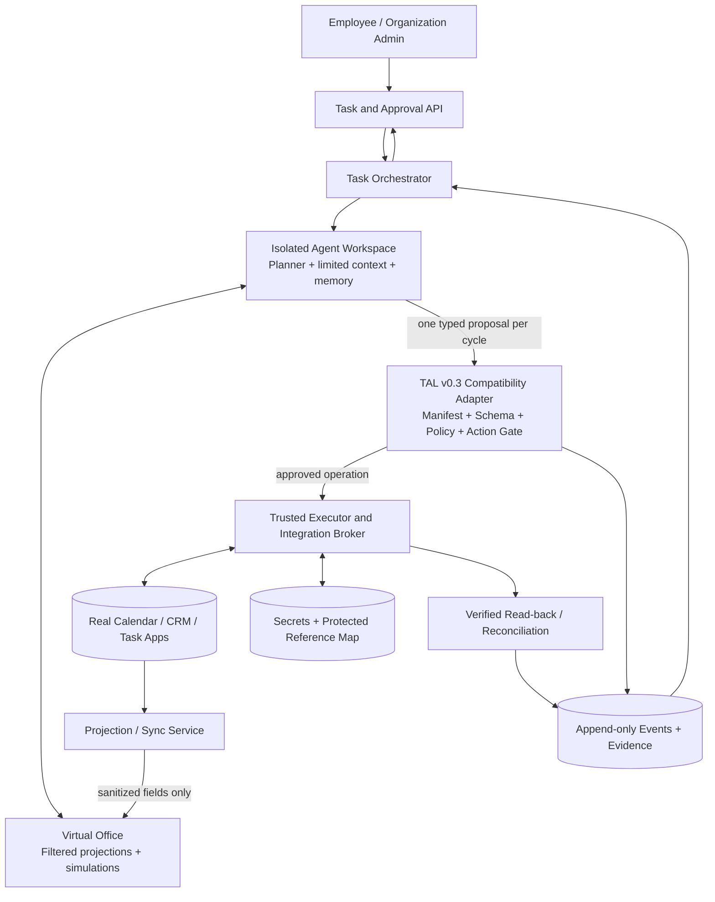
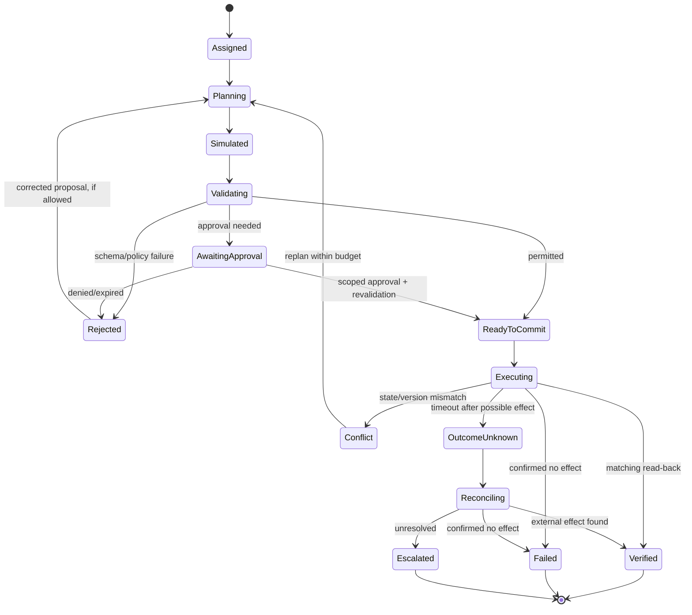

# TERVORO SAFE-AGENT
## System Design Specification

**Version:** 1.0 — Proposed Design  
**Date:** October 13, 2026  
**Project:** [AWDaley/SAFE-AGENT](https://github.com/AWDaley/SAFE-AGENT)  
**Intended audience:** Project owner, engineering contributors, and Codex  
**Status:** Design proposal; not a claim of implemented functionality

> **Product thesis:** SAFE-AGENT is a persistent AI office worker that operates on permission-filtered representations of business applications. It plans and tests changes in its Virtual Office, while a deterministic TAL harness exclusively authorizes and executes changes to real systems, with independent evidence of the result.

---

## 1. Executive summary

Small organizations operate across calendars, customer records, task lists, email, and document systems. Routine coordination is repetitive, but giving an LLM unrestricted access to those systems creates risks involving incorrect changes, privacy, permissions, duplicated operations, and false claims of task completion.

**SAFE-AGENT** addresses this through four components:

1. **Persistent agent workspace:** A dedicated environment containing task state, relevant memory, plans, and a limited set of typed actions.
2. **Virtual Office:** Permission-filtered projections of external applications and local simulations for planning changes without immediately applying them.
3. **TAL deterministic harness:** A single authorization and execution boundary that validates typed proposals, enforces task contracts and approvals, records events, and verifies completion.
4. **Trusted integration/data layer:** Connectors to real applications, a secret store, and a reference broker that resolve sensitive data without putting raw credentials or unnecessary personal information into the model context.

The real business applications remain **systems of record**. The Virtual Office is a working representation, not an independent source of truth or a full emulator of third-party software. Simulation success is not authorization, and authorization is not proof of completion.

### 1.1 Current project assumptions

The public SAFE-AGENT repository currently contains a basic README. This specification therefore describes an intended implementation rather than asserting that the repository already contains the components below. TAL v0.3 is treated as an existing separately developed governance design; SAFE-AGENT should integrate through a compatibility layer rather than silently rewrite or weaken TAL's invariants.

### 1.2 First deliverable

A **single-organization, single-agent MVP** able to inspect synthetic customer records, inspect and simulate calendar availability, propose a routine appointment, pass the proposal through TAL, commit through a controlled adapter, and independently verify the result. One production calendar connector is introduced only after the synthetic workflow passes security and recovery tests.

## 2. Product goals and boundaries

### 2.1 Goals

- Complete narrow administrative workflows end to end with reliable, evidence-backed status reporting.
- Interoperate with existing software instead of forcing users to migrate to a new office suite.
- Allow the agent to plan and simulate changes in a persistent workspace before real-world effects.
- Apply least privilege at task, actor, resource, data, operation, and parameter levels.
- Keep credentials and raw sensitive records out of the model context by default.
- Make every externally effective action attributable, auditable, recoverable when possible, and verified.
- Permit gradually broader autonomy through explicit domain contracts and measured reliability.
- Provide a usable interface for assignments, previews, approvals, status, and exceptions.

### 2.2 Non-goals for the MVP

- Reproduce full UIs or behavior of Google Workspace, Microsoft 365, or a CRM.
- Give the model unrestricted browser, operating-system, shell, database, or network access.
- Make unsupervised financial transfers, irreversible deletions, account administration changes, or legal/compliance determinations.
- Send arbitrary customer-facing email generated by the model without explicit controls.
- Support arbitrary third-party application plugins or multiple cooperating agents.
- Guarantee legal or regulatory compliance merely by passing deterministic rules.
- Claim that opaque identifiers make data anonymous or eliminate metadata leakage.

### 2.3 Hard architectural invariants

1. **The model proposes; TAL disposes.** Only the trusted harness invokes external-effect tools or mutates authoritative task state.
2. **Exactly one typed model proposal per TAL cycle, and at most one external effect per cycle**, preserving the intended TAL v0.3 execution boundary.
3. **No direct model-to-connector path.** Model-visible tool descriptions are not executable provider credentials or direct API capabilities.
4. **Deny by default.** Missing authority, invalid schemas, stale state, unknown outcomes, or unverified approvals cannot silently become permission.
5. **Requested authority never increases effective authority.** Task text, retrieved documents, simulation results, and child tasks cannot grant privileges.
6. **Immutable contracts and append-only evidence.** Policy/manifest changes produce new versions; task state is derived from recorded events.
7. **Rejection is side-effect free.** Denied proposals do not call effectful tools, change authoritative state, or consume an external idempotency reservation.
8. **Only the harness declares verified completion.** The model cannot mark its own task successful.
9. **The real application is authoritative at commit time.** Recheck current state, version, permissions, and action-specific preconditions.
10. **Sensitive information is minimized, not magically removed.** Only the trusted layer resolves protected handles or uses credentials.

## 3. Users and first workflows

**Organization administrator:** Connects applications, delegates task scopes, configures business rules and approvals, and reviews audit records.

**Office employee:** Delegates routine scheduling and recordkeeping work; monitors progress; approves exceptions when necessary.

**SAFE-AGENT:** Plans against a permission-filtered Virtual Office and submits structured proposals; cannot directly perform privileged writes.

**Reviewer/auditor:** Inspects approved/rejected actions, evidence, policy versions, exceptions, and recovery history.

### MVP workflows

| Workflow | Agent actions | Commit policy |
|---|---|---|
| Schedule follow-up | Resolve permitted customer reference, inspect free/busy, simulate appointment, propose create | Automatically commit within an explicit task grant; independently verify |
| Reschedule appointment | Read permitted appointment reference, propose revised slot, simulate conflict and time-zone behavior | Version-check existing event; require approval if task grant says so |
| Maintain task list | Create/update a structured internal task tied to a permitted customer reference | Allow within task scope; verify write |
| Prepare confirmation | Choose an approved template and required references | Prepare preview in MVP; sending is a separate authorized action in later phase |

The initial customer database may be entirely synthetic. The first real integration should be **one calendar provider** (Google Calendar recommended for the initial connector). Outlook/Microsoft Graph follows only after adapter conformance is demonstrated.

## 4. High-level architecture



### 4.1 Subsystem responsibilities

| Subsystem | Responsibility | Trust level |
|---|---|---|
| Task/API interface | Receive assignments, show status, collect approvals, expose audit results | Authenticated application surface |
| Task orchestrator | Advance task lifecycle, enforce cycle limits, manage retries and escalations | Trusted runtime |
| Agent workspace | Model inference, plans, scratch state, allowed structured context | Untrusted for security decisions |
| Virtual Office | Sanitized state projections and side-effect-free previews | Advisory state, not authority |
| TAL compatibility adapter | Compile and pin task manifests; validate one typed proposal; use TAL action gate and reducer | Trusted control plane |
| Reference/data broker | Validate opaque references and supply minimally necessary fields to trusted adapters | Privileged |
| Integration adapters | Provider-specific reads, writes, conditional operations, and evidence retrieval | Privileged, least-permissioned |
| Event ledger/verifier | Record transitions and verify externally observable postconditions | Trusted evidence plane |

**Deployment boundary:** the model worker must not possess production connector tokens, secret-store access, write-capable database credentials, or unrestricted network egress. Containerization alone is not proof of isolation; enforce network policies and service identities as well.

## 5. The Virtual Office

The Virtual Office is an **application-neutral domain representation** with three modes.

1. **Observe:** Sync relevant state from an application into a permission-filtered projection (e.g., available/busy slots, appointment references, task status). Every projection records freshness and its source version when available.
2. **Simulate:** Apply proposed changes to a disposable, versioned working copy. Compute a preview, changed objects, obvious conflicts, and expected postconditions. No provider write occurs.
3. **Commit:** Submit the typed action plus simulation reference to TAL. TAL and the trusted adapter revalidate current external state and either perform the permitted write or reject/escalate it.

The simulator should model only the business operations SAFE-AGENT supports. The early calendar domain needs events, recurrence limitations, availability windows, work hours, appointment types, and time zones—not an entire clone of the Google Calendar interface.

### 5.1 Projection design

A projection has `projection_id`, `tenant_id`, `connector_id`, `resource_scope`, `source_revision` (when supported), `synced_at`, `valid_until`, sanitized domain objects, and a data-classification marker. Protected raw records are not copied into the agent-visible store.

Projection freshness is advisory. Before committing, the connector always re-queries critical fields. For existing resource updates, use provider conditional updates (ETag/version mechanisms) when supported. For new appointment creation, check conflicts just before submission; if the provider does not support atomic reservation, acknowledge that a race may still exist and reconcile the result.

Google Calendar documents incremental sync tokens and ETag-based conditional modifications; Microsoft Graph documents calendar-view delta queries. These are implementation aids, not a guarantee that every business condition can be enforced atomically across systems.

### 5.2 Simulation output

Each preview should produce:

- A human-readable description of proposed changes, using safe display labels.
- A typed change set and expected postconditions.
- The projection revision and assumptions used.
- Known conflicts, ambiguities, and unmodeled behaviors.
- A simulation identifier and deterministic content hash.

**A successful simulation never grants permission or bypasses revalidation.**

## 6. Sensitive information and opaque references

The model receives only task-necessary facts and **scoped handles**, while the privileged broker retains the protected mapping.

| Protected information | Model-visible substitute |
|---|---|
| Customer name, email, phone | `customer_ref_a9` and approved non-identifying attributes |
| Sensitive calendar description | `appointment_type: follow_up`; availability interval |
| Provider event ID | `event_ref_p2` |
| OAuth refresh/access token | No model-visible equivalent |
| Recipient's address for confirmation | `notification_channel_ref_k4` |

A handle must be bound to tenant, initiating principal, task, resource, permitted operations, issuance and expiry, and ideally a specific authority/manifest version. It is **not** a bearer permission simply because it is hard to guess; the broker must check authority independently on every resolution.

**Privacy guardrails:**

- Use filtered views and derived fields, not reversible textual substitution alone.
- Do not log raw records or secrets into prompts, telemetry, errors, audit notes, or model memory.
- Treat customer-provided documents, email bodies, and imported records as untrusted content; they never create new instructions or privileges.
- Use trusted templates to merge sensitive recipient details at the final execution step, after approval.
- Recognize that derived facts (including precise event times, counts, or unique categories) can still reveal personal information; minimize them by task.
- If a task cannot be fulfilled with permitted information, request an authorized exception or escalate; do not silently reveal raw data.
- Apply tenant isolation, retention/deletion policies, encryption at rest and in transit, and credential rotation independently of model behavior.

For MVP, **do not ingest arbitrary unstructured inbox content into the agent**. Broader secure content interpretation requires a separate threat model and may need a private processing path.

## 7. Task manifests and TAL integration

Every task runs under an immutable, versioned **authority manifest** compiled before the model begins. The task manifest should define:

| Category | Example |
|---|---|
| Identity | Organization, initiating employee, execution service identity |
| Objective | Schedule one permitted follow-up appointment |
| Input/data scope | Customer reference, calendar availability, authorized calendar |
| Allowed operations | `calendar.free_busy`, `calendar.create_event`, `tasks.create` |
| Parameter constraints | Business hours; max 60 minutes; permitted calendar; approved appointment template |
| Prohibitions | No deletion, arbitrary outbound messages, private-event descriptions, or cross-tenant records |
| Budget | Model cycles, read calls, effectful actions, tokens, monetary cap |
| Approvals | Approval-required operation classes and approver identity |
| Recovery | Retry ceilings, reconciliations, escalation policy |
| Completion evidence | Created event reference, matching times/participants, provider read-back |

SAFE-AGENT should reuse the existing **TAL v0.3** compiler, action gate, append-only event model, pure state reducer, replay, and completion semantics. If the current TAL implementation is in a separate repository, build an adapter with contract tests; do not copy its rules into model prompts. Any new language feature should be versioned explicitly rather than silently changing the frozen v0.3 protocol.

A policy engine such as OPA may be placed behind the TAL policy interface if useful, but it does not replace the manifest, state machine, privileged execution broker, or verifier.

### 7.1 Example model-visible proposal

The model submits a structured proposal only; trusted runtime metadata such as authenticated identity, idempotency reservation, manifest hash, and provider credentials are added **outside** the model.

```json
{
  "schema_version": "safe_agent.proposal.v1",
  "operation": "calendar.create_event",
  "calendar_ref": "calendar_scope_01",
  "customer_ref": "customer_ref_a9",
  "start_at": "2026-10-15T14:00:00-04:00",
  "end_at": "2026-10-15T14:30:00-04:00",
  "time_zone": "America/New_York",
  "template_id": "follow_up_v1",
  "simulation_ref": "simulation_8b",
  "projection_rev": "projection_42"
}
```

The trusted layer binds this proposal to the authenticated initiating task and its exact manifest. It validates reference scopes, schema, permitted calendar, appointment duration, local-time validity (including DST anomalies), conflict checks, task budget, and required approvals. It computes its own canonical action hash and idempotency record.

### 7.2 Risk tiers

| Tier | Examples | Default behavior |
|---|---|---|
| R0 — Read | Free/busy lookup, permitted task status | Automatic after authorization |
| R1 — Reversible routine | Create internal task; schedule ordinary meeting | Automatic only within explicit task contract |
| R2 — External communication or consequential update | Send approved customer template; modify existing sensitive record | Require stronger rules and possibly human approval |
| R3 — Irreversible/high-impact | Deletion, payments, account privilege changes | Not supported by MVP; deny |

A tier is not sufficient authority by itself. Each action still needs an exact operation grant, tenant/resource binding, parameter checks, and any required approval.

## 8. Execution lifecycle

The agent may plan repeatedly, but each TAL cycle accepts exactly one typed proposal and performs **no more than one external effect**. Creating a calendar event and sending a confirmation are separate cycles and separately verified actions.



### 8.1 Commit pipeline

1. Authenticate task identity and pin its compiled authority manifest.
2. Parse the single typed proposal under a closed schema; reject unknown operations/fields.
3. Resolve handles in the trusted broker without exposing underlying secrets to the model.
4. Validate authority, resource/parameter scope, current task state, budgets, and approvals.
5. Check projection and current provider state; use conditional/versioned operations where available.
6. Reserve a trusted idempotency key and append the execution-intent event before a possible external side effect.
7. Invoke **one** privileged adapter operation through TAL's action gate.
8. Read back the provider result or enter explicit reconciliation for an unknown outcome.
9. Append evidence; apply the pure reducer; verify the expected postcondition.
10. Return a sanitized result. The task is complete only when its required postconditions are independently satisfied.

Approval is bound to the exact proposed operation and relevant parameters, with an expiry. A stale approval does not permit a different or substantially changed action.

### 8.2 Failure and recovery semantics

- **Rejected proposal:** no effectful tool call and no side effects.
- **Definitive provider rejection:** record confirmed failure, bounded correction or escalation.
- **Conflict/stale projection:** refresh authorized state and replan; never overwrite silently.
- **Timeout after dispatch:** mark `OUTCOME_UNKNOWN`; query external state using action identifiers or provider-specific reconciliation. Do not blindly retry an operation that may have succeeded.
- **Worker crash:** recover from durable events and outbox records; resume at an allowed state transition, not from an untrusted text summary.
- **Duplicate delivery:** use idempotency and reconciliation to prevent duplicate actions as far as supported by the external system.
- **Irreversible operation:** do not claim rollback is guaranteed; escalate where safe compensation is unavailable.

Provider APIs differ; a reliable adapter must disclose which conditional writes, idempotency mechanisms, and read-after-write guarantees are actually supported.

## 9. Data model and storage

| Entity | Important fields |
|---|---|
| `Task` | Task ID, tenant, initiator, objective, state, manifest hash, current cycle, deadline |
| `AuthorityManifest` | Version, signature/hash, permissions, scope, parameters, budget, approvals |
| `ScopedReference` | Opaque handle, tenant/task/actor binding, resource mapping, operations, expiry |
| `Projection` | Connector and scope, sanitized state, provider revision, sync time, expiry |
| `Simulation` | Input projection rev, proposed change set, result, assumptions, output hash |
| `ActionProposal` | Closed-schema action, source task, simulation ref, status |
| `Approval` | Approver, proposal hash, decision, expiry, provenance |
| `ExecutionRecord` | Canonical action hash, idempotency key, adapter, dispatch state, external effect ref |
| `EvidenceEvent` | Event ID, sequence, prior hash, event type, policy/version info, sanitized receipts |
| `TaskMemory` | Approved useful facts/procedures, scope, provenance, expiry, supersession |

Use PostgreSQL as the MVP durable store. Separate protected reference mappings, OAuth credentials, and other secrets from model-visible tables; restrict database roles and service identities. The event ledger is append-only at the application layer with hash-linking for tamper evidence. This is **not** equivalent to proving tamper resistance against a fully compromised database administrator or hosting environment.

Memory is not automatically authoritative. Only validated user preferences or proven workflow data may influence future plans, and no memory entry can enlarge task authority.

## 10. Interfaces and integration contracts

### 10.1 Initial domain interface

```python
class CalendarAdapter(Protocol):
    async def get_free_busy(self, scoped_calendar, window): ...
    async def get_event(self, scoped_event): ...
    async def create_event(self, approved_request, effect_id): ...
    async def update_event(self, approved_request, expected_version, effect_id): ...
    async def find_effect(self, effect_id): ...
    async def verify_event(self, expected_postcondition): ...
```

The protocol is illustrative; exact typed schemas and provider capability declarations belong in the implementation. All methods with provider effects are called only by the privileged executor. The model sees a separate, narrowly typed proposal vocabulary.

### 10.2 Suggested internal API surface

| Endpoint / command | Function |
|---|---|
| `POST /tasks` | Create task under authenticated principal and selected contract |
| `GET /tasks/{id}` | Task state, safe summary, recent evidence |
| `GET /tasks/{id}/preview` | Virtual Office simulation and proposed diff |
| `POST /tasks/{id}/approvals` | Approve/deny a specific pending action hash |
| `GET /tasks/{id}/events` | Permission-filtered evidence ledger |
| `POST /connections/calendar` | Start administrator-approved OAuth flow |
| `POST /admin/policies/validate` | Validate contract without enabling it |

Administrative APIs must not be callable through model-proposed arbitrary HTTP requests. Write endpoints must enforce independent user authentication, organization-level authorization, and CSRF/session controls as appropriate.

## 11. Security and threat model

| Threat | Principal mitigation | Required negative test |
|---|---|---|
| Prompt injection in task data | Treat retrieved content as data; closed actions; independent policy | Embedded instruction to exfiltrate data has no authority |
| Escalated permissions | Immutable task manifest; exact operation/parameter policy; source identity binding | “Ignore policy” and forged manifest claims are denied |
| Sensitive data leakage | Permission-filtered projections; trusted reference broker; secret isolation | Names/emails/tokens never appear in model-visible request or logs |
| Cross-tenant access | Tenant-bound handles and DB policies; authn/authz at broker | Handle from tenant A fails in tenant B |
| Stale data / racing updates | Source-version checks; precommit refresh; reconciliation | Conflicting event cannot silently overwrite existing state |
| Duplicate execution | Outbox, idempotency, external-effect reconciliation | Crash/retry does not create a second appointment |
| Forged completion | Evidence verifier, task postconditions, harness-only completion | Model saying “done” cannot complete an unverified task |
| Malicious/compromised connector | Adapter capability limits, pinned provider endpoints, scope restrictions, audit | Adapter cannot exceed delegated API scopes |
| Log or memory injection | Sanitization, provenance, immutable authority semantics | Injected historical note cannot change task permissions |

Deterministic validation establishes whether an action meets **specified rules**, not whether it is universally wise, factually correct, or legally compliant. Human review and organization-specific legal/security assessment remain necessary for regulated use cases.

## 12. User experience

The MVP UI should be intentionally small:

- **Task inbox:** Request, assigned agent, current state, next step, and outcome evidence.
- **Virtual Office preview:** Proposed change, relevant simulated before/after state, conflicts, and limitations.
- **Approval queue:** Exact action to authorize, affected app, risk tier, expiry, and deny option.
- **Connections and permissions:** Visible integrations, granted scopes, and easy disconnection.
- **Audit detail:** Timeline of proposal, checks, approval, dispatch, and verified postcondition.

Users should see meaningful statuses such as **Planning**, **Awaiting approval**, **Conflict**, **Verifying**, **Completed**, and **Needs review**. A model-generated narrative is not a substitute for verified status.

## 13. Recommended implementation approach

**Architecture:** Modular Python monolith for the MVP with clearly separated trust boundaries, not premature microservices.

| Area | Suggested implementation |
|---|---|
| Backend/orchestration | Python 3.12+, FastAPI, Pydantic v2, typed domain services |
| Durable storage | PostgreSQL, SQLAlchemy, Alembic migrations |
| Model abstraction | Provider-neutral model interface with structured proposal output |
| Simulation | Deterministic Python domain logic with seeded synthetic fixtures |
| TAL enforcement | Reuse frozen TAL v0.3 core through a tested adapter; optional OPA behind policy interface |
| Integrations | Adapter interface plus synthetic calendar/CRM; Google Calendar adapter first |
| Background work | Durable PostgreSQL-backed queue/outbox initially; introduce more infrastructure only if needed |
| Frontend | Minimal React/TypeScript dashboard after backend conformance tests |
| Packaging/tests | Docker Compose for local development; pytest, property tests, fault injection, CI |
| Observability | Correlated task/action IDs, redacted structured logs, event replay, metrics |

### 13.1 Proposed repository layout

```text
SAFE-AGENT/
  README.md
  docs/
    SAFE_AGENT_DESIGN.md
    decisions/
    threat-model.md
    api-contracts.md
  safe_agent/
    api/                  # authenticated user/admin endpoints
    orchestrator/         # task lifecycle, limits, recovery
    agent/                # provider-neutral model boundary
    virtual_office/       # sanitized projections, simulation
      domains/
        calendar/
        tasks/
        customers/
    tal_adapter/          # interface to frozen TAL core
    policy/               # manifest validation and risk rules
    broker/               # scoped handles; never model-visible raw mappings
    connectors/           # privileged provider adapters
      fake/
      google_calendar/
    evidence/             # append-only events, reducer, verifier
    persistence/          # SQL models, migrations, outbox
    security/             # authn/authz, secret access, logging redaction
  tests/
    unit/
    integration/
    adversarial/
    recovery/
    acceptance/
  fixtures/
    synthetic_office/
  web/                    # optional initial dashboard
  compose.yaml
  pyproject.toml
```

The `tal_adapter` package should be thin. If TAL's independently maintained code already defines an equivalent operation or store, import and conform to it rather than creating another authoritative action gate.

## 14. Test plan and success measures

### 14.1 Mandatory conformance tests

1. Model cannot call connector code or network endpoints directly.
2. Unknown action names, extra fields, malformed references, and unsupported parameters are denied.
3. Denied actions have no external effects and do not consume effectful idempotency reservations.
4. Scope/tenant/approval checks cannot be bypassed by prompt text or stored memory.
5. A stale event version is detected before a conflicting update.
6. A timeout after an actual provider write enters reconciliation and resolves without duplicate effects.
7. A worker crash can be replayed from authoritative events and the outbox.
8. A forged “task complete” message cannot bypass postcondition verification.
9. Raw private fields and secrets are excluded from model-visible state, logs, and exportable evidence.
10. A customer confirmation requires its own authorized action after event creation.
11. A changed proposal invalidates a prior action-specific approval.
12. Local date/time conversion correctly handles time zones and ambiguous/nonexistent DST instants.

### 14.2 Benchmarks

Run identical synthetic tasks with the same model, tools, budget, fixtures, and outcome evaluator across three configurations:

- **Control:** Common runner with baseline structured tools, without TAL enforcement enabled.
- **TAL shadow:** Same runner and typed proposal structure, with TAL checks recorded but not used to block operations; keep this configuration inside a safe simulator.
- **TAL enforced:** Same runner, with active TAL authorization, event ledger, recovery, and verification.

Track **verified task completion**, unauthorized side effects, wrong-target changes, false blocks, duplicate effects, missed conflicts, recovery rate, latency, token/tool cost, and human-review workload. Blind or independent evaluation should judge business end state, not the model's claims. Explicitly record policy/manifest hashes, model IDs, task fixture versions, and budget settings so comparisons are reproducible.

### 14.3 Proposed MVP exit criteria

These are **acceptance targets, not claims of current performance**:

- All defined unauthorized-operation cases in the conformance suite are blocked before external effects.
- Every reported successful task has independent evidence matching required postconditions.
- Zero duplicate external effects in the defined crash/retry and unknown-outcome fault suite.
- Zero exposed raw credentials or protected fields in the defined prompt/log leakage tests.
- At least **90%** verified completion on an agreed held-out set of unambiguous synthetic routine tasks, with failures categorized and reviewed.
- Every live-calendar action can be traced to initiating identity, pinned manifest, proposal, validation, dispatch, and read-back evidence.

A test suite cannot prove universal security. The targets must be revisited as task diversity and deployment risk increase.

## 15. Implementation milestones

| Milestone | Deliverable | Exit condition |
|---|---|---|
| **M0 — Contracts and architecture** | Repo scaffolding, frozen assumptions, typed schemas, TAL compatibility tests, synthetic fixtures | Contracts compile; model has no privileged tool access |
| **M1 — Virtual Office** | Synthetic customer/calendar/tasks; safe projections; deterministic simulation and preview | Simulations are reproducible, effect-free, and versioned |
| **M2 — TAL execution path** | Manifest pinning, one action gate, reducer, append-only events, schema/policy rejection | All negative authority tests pass; rejected actions have no effects |
| **M3 — Safe commits and recovery** | Privileged fake adapters, outbox, idempotency, verifier, reconciliation | Crash/retry/conflict suite passes with no duplicate effects |
| **M4 — Real calendar connector** | Admin-approved OAuth, Google Calendar reads/writes, conditional checks, verified read-back | End-to-end live sandbox calendar task works without model secrets |
| **M5 — Operator experience** | Task view, preview, approvals, connection settings, auditable status | Human can assign, inspect, approve/deny, and diagnose a task |
| **M6 — Evaluation and hardening** | Held-out benchmark, threat-model review, benchmark report, operational guidance | MVP exit criteria achieved; major unresolved risks documented |

**Recommended development order:** implement and certify the synthetic system before connecting production data. Add one external provider only after the action gate and reconciliation logic are proven under fault injection.

## 16. Future expansion

Once the calendar vertical slice is reliable, add versioned domain packs for CRM management, email templates, document organization, and accounting-adjacent administrative work. Each pack must declare operations, schemas, authorized data scope, simulator behavior, connector capabilities, risk classifications, and independent completion checks.

Later capabilities may include richer persistent memory, customer-specific workflow rules, scheduling triggers, multiple provider adapters, and narrowly coordinated subagents. None should introduce a second authority plane or bypass TAL's single action gate. Support for arbitrary private-text understanding should be investigated separately from the initial data-minimized model.

## 17. Decisions still to make

1. **Initial environment:** Hosted single-tenant service versus customer-hosted deployment. Begin with a local synthetic environment until the trust boundary is tested.
2. **Real calendar provider:** Google Calendar is the proposed first connector; this is a product decision, not a protocol requirement.
3. **TAL code boundary:** Exact interface for importing the existing v0.3 implementation, location of event ledger, and ownership of manifest compilation need to be settled against the actual codebase.
4. **Customer-record source:** Begin with a synthetic registry; choose a real CRM only after calendar conformance passes.
5. **External communication:** Approved templates, recipient resolution, and human approval policy must be finalized before enabling message delivery.
6. **Sensitive unstructured content:** Decide later whether selected tasks can be handled with redacted fields or require a separate protected processing environment.

## 18. References and implementation notes

- [SAFE-AGENT project repository](https://github.com/AWDaley/SAFE-AGENT)
- [Google Calendar: incremental synchronization](https://developers.google.com/workspace/calendar/api/guides/sync)
- [Google Calendar: ETags and conditional modifications](https://developers.google.com/calendar/api/guides/version-resources)
- [Microsoft Graph: event delta synchronization](https://learn.microsoft.com/en-us/graph/delta-query-events)
- [MCP authorization and security guidance](https://modelcontextprotocol.io/specification/2025-11-25/basic/authorization)
- [Open Policy Agent documentation](https://www.openpolicyagent.org/docs)
- [OWASP AI Security and Privacy Guide](https://github.com/OWASP/www-project-ai-security-and-privacy-guide)

---

**Primary engineering decision:** Build a practical and measurable office agent around **one persistent workspace, one Virtual Office projection/simulation layer, and one TAL-governed execution boundary**. Expand supported tasks only after real external outcomes are consistently verified and privacy/authority invariants remain intact.